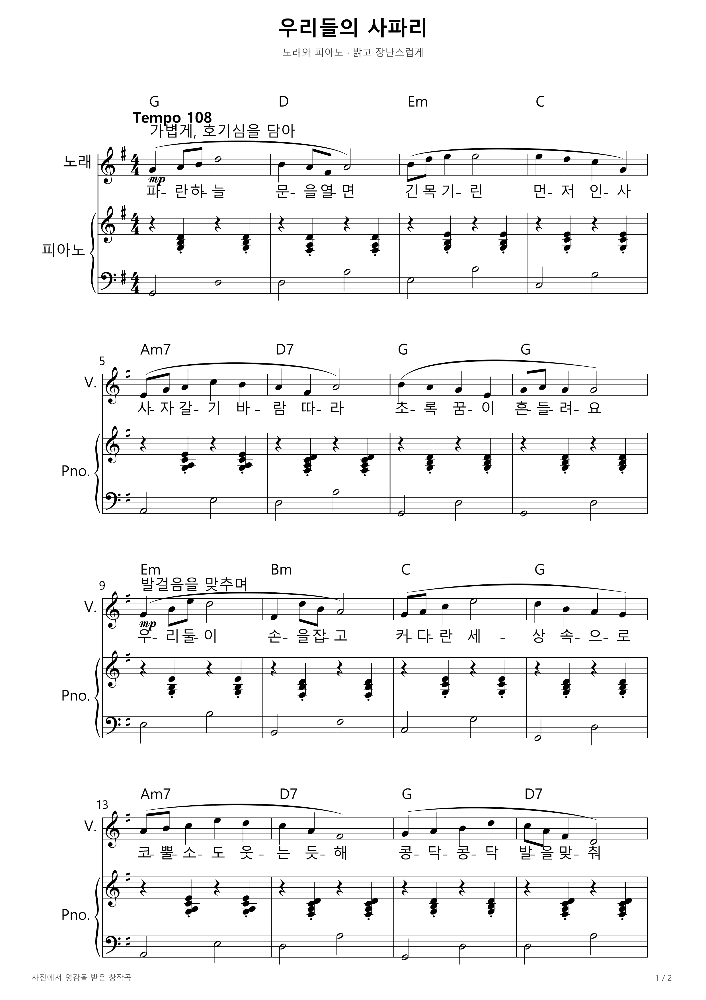
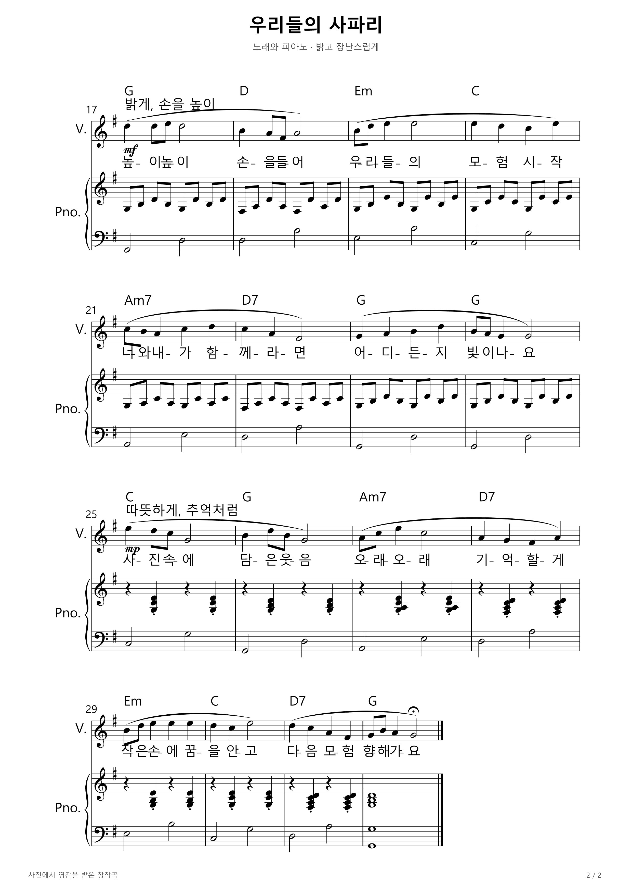

# 우리들의 사파리

사진에서 영감을 받아 작성한 한국어 가사, 32마디 노래 선율과 피아노 반주의 창작 예시입니다. G장조, 4/4박자, 템포 108로 구성했습니다. 장면 해석 후 직접 작곡한 결과이며, 신규 학습 모델의 자동 생성 성능을 나타내지 않습니다.

## 악보 1쪽

## 악보 2쪽

## 빛이 머무는 골목

새 사진에서 만든 32마디 노래와 피아노 편곡: [악보 이미지와 편집 파일 보기](sunlit-lane/README.md).

## 웃음이 번지는 순간

새 사진에서 만든 6/8박자 노래와 피아노 편곡: [악보 이미지와 편집 파일 보기](smile-moment/README.md).

## 웃음이 번지는 순간 · Acoustic K-pop 리메이크

같은 사진에서 새로 만든 C장조·4/4박자·템포 88의 32마디 편곡입니다. 보컬·피아노·베이스·드럼 악보와 PDF, 편집·연습 파일: [새 케이팝 버전 보기](smile-moment-kpop/README.md).

## 한 판 더 · 랩과 피아노 반주

게임 패배 뒤의 분함을 담은 창작 랩입니다. A단조·96 BPM·32마디이며, 기존 피아노 학습 모델의 추론과 직접 작성한 랩 가사·리듬을 결합했습니다.

[가사와 악보 안내](han-pan-deo/README.md) · [피아노 반주 MP3](han-pan-deo/piano/backing.mp3) · [랩+피아노 악보 PDF](han-pan-deo/rap/score.pdf) · [전체 ZIP](han-pan-deo/han-pan-deo-rap-piano.zip)

MP3에는 랩 목소리 없이 피아노 반주만 포함됩니다. 사진 원본은 포함하지 않았습니다. 연구·비상업용 모델 이용 조건은 안내 문서를 참고하세요.
