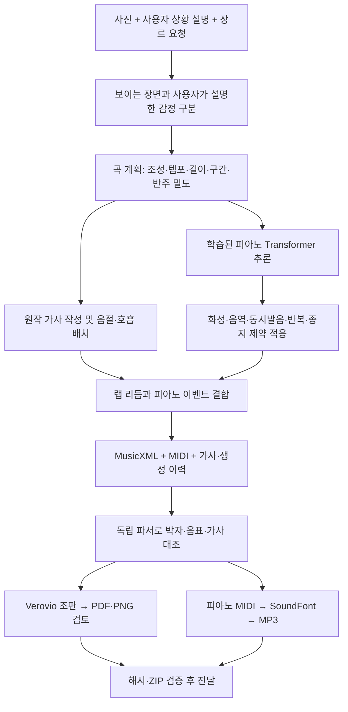

# OMR 프로젝트 처리 프로세스·모델·데이터셋·학습 전략 상세 보고서

작성 기준일: 2026-10-29, 한국 시간. 최종 피아노 학습 기록은 2026-10-28 실행분이며, 최근 사용자 샘플은 **〈한 판 더〉**이다. 이 문서는 저장된 코드·manifest·체크포인트·학습 로그·산출물 검증 기록을 근거로 작성했다. 이번 문서 작성 과정에서 새 학습을 실행하지 않았다.

## 1. 현재 구현 상태

현재 최종 음악 생성 경로는 **실제 피아노 악보의 양손 음표를 함께 학습한 소형 자기회귀 Transformer와 명시적인 작곡·편곡 제약을 결합하는 방식**이다. 사진과 상황을 이해하고, 곡의 목적·감정·형식을 정하는 단계는 음표 생성 모델과 분리되어 있다.

사용자가 앞서 케이팝 합주를 줄이고 피아노에 집중하도록 요청해, 최종 음악 모델을 피아노 전용으로 새로 학습했다. 이후 요청한 랩 샘플은 이 피아노 모델에 원작 랩 가사와 말하기 리듬을 결합했다. 해당 샘플의 장르를 랩으로 지정했다고 해서 피아노 모델을 랩 데이터로 다시 학습한 것은 아니다.

| 구분 | 현재 상태 |
|---|---|
| 기본 생성 대상 | 피아노 한 대의 양손 기호 음표 |
| 최종 모델 | OMR 양손 통합 피아노 Transformer, 최종 실험 v3 |
| 실제 가중치 학습 | 완료: 866개 학습 파일, 6 epoch |
| 전체 정리 자료 | 1,215개 파일, 584개 작품 그룹 |
| 가사·사진과 음악의 공동 학습 | 최종 피아노 모델에서는 수행하지 않음 |
| 최근 랩 샘플 | 원작 가사·무음고 리듬 표기 + 학습 모델을 사용한 피아노 반주 |
| 오디오 생성 | MIDI를 피아노 SoundFont로 렌더링 |
| 실제 랩 보컬 합성 | 현재 샘플에는 없음 |
| 사용 형태 | 로컬 스크립트·CLI와 결과 파일. 별도의 테스트 화면은 만들지 않음 |
| 배포 상태 | 결과 파일을 `thecar1771/dd`에 게시. 최종 피아노 가중치·학습 자료는 로컬 보존 |

`v3`는 최종 피아노 실험 폴더의 버전 구분이다. 과거의 성악+피아노 `score-v3` 실험과는 다른 가중치·토크나이저다. 아래 모델명은 외부에 등록된 제품명이 아니라 프로젝트 내부 식별명이다.

## 2. 현재 처리 프로세스



### 2.1 입력과 장면 해석

입력은 사진, 현재 상황, 사용자가 느끼는 감정, 원하는 장르다. 최근 입력의 경우 사진에서 실내의 웃는 인물을 확인했고, 게임에서 후배에게 졌다는 사건과 비웃음을 받아 분하다는 의미는 **사용자 설명**에서 가져왔다. 얼굴 표정만으로 관계·의도·분노의 원인을 추정한 것이 아니다.

프로젝트에는 초기 SmolVLM 및 별도 v2의 Qwen3-VL 사진 해석 코드가 있다. 그러나 최근 〈한 판 더〉 샘플에서 이 두 로컬 모델이나 초기 장면 키포인트 체크포인트를 실행했다는 기록은 없다. 해당 샘플은 대화에서 확인한 사진과 사용자 설명을 작곡 조건으로 옮겼다. 이를 완전히 자동화된 사진→감정→음악 모델의 평가 결과로 표시하면 안 된다.

### 2.2 곡 계획

사용자의 설명을 바탕으로 조성, BPM, 박자, 마디 수, 구간별 에너지, 가사 길이, 반복 구간을 정한다. 이 매핑은 현재 별도 작곡 판단·규칙이다. 최종 피아노 모델이 `분노`, `게임 패배`, `후배`, `재대결` 같은 문장을 읽어 화음이나 리듬을 직접 결정하지는 않는다.

최근 샘플은 A단조, 96 BPM, 4/4박자, 32마디로 구성했다. 인트로 뒤에 두 절과 두 번의 후렴을 배치하고 아웃트로로 마무리했다. 후렴 재현과 마지막 으뜸화음은 명시적으로 지정했다.

### 2.3 가사와 랩 리듬

먼저 완전한 문장으로 가사를 쓰고 음절 수를 확인한다. 최근 샘플은 한 줄을 한 마디에 배치하며, 한 마디의 15개 16분음표 격자에 음절을 배분하고 마지막 16분음표 길이는 호흡 여유로 둔다. 짧은 문장은 어절 끝의 유지 시간을 늘린다. 길이가 맞지 않는 문장은 다시 작성하며 끝부분을 잘라 맞추지 않는다.

랩은 `unpitched` 이벤트와 × 모양 음표로 표기한다. 이 음표는 말하는 타이밍을 나타내며 노래의 음높이 정답을 의미하지 않는다. 전체 가사 TXT, LRC 시간표, 줄별 JSON을 함께 만든다. 현재 가사 작성은 학습된 한국어 작사 모델의 출력 성능 평가가 아니다.

### 2.4 피아노 추론과 편곡

학습된 체크포인트를 읽고, 앞 마디와 조건 토큰을 넣어 다음 음표 토큰의 확률을 계산한다. 허용된 음역·화음·리듬 후보 안에서 샘플링한다. 일반 피아노 독주 경로와 최근 랩 반주 경로의 제약은 다르다.

| 항목 | 피아노 독주 예제 | 최근 랩 반주 예제 |
|---|---|---|
| 대표 결과 | 고요한 하루, 따뜻한 발걸음 | 한 판 더 |
| 조성·템포 | C장조, 76 BPM | A단조, 96 BPM |
| 음표 선택 | 양손 통합 모델의 조건부 샘플링 | 오른손 화음과 세기를 모델에서 샘플링 |
| 리듬·왼손 | 생성 문법·화성 제약 안에서 선택 | 직접 설계한 절제된 붐뱁 피아노 리듬과 근음·5도 패턴 |
| 곡 형식 | Intro–A–B–A 재현–Coda | Intro–Verse 1–Hook–Verse 2–Hook–Outro |
| 후렴·재현·종지 | 작곡 보조 설정 | 작곡 보조 설정 |

따라서 현재 결과는 **모델 추론과 편곡 로직을 결합한 곡**이다. 모든 음표나 곡 형식을 무제약 모델이 독립적으로 만든 것으로 해석하지 않는다.

### 2.5 파일 출력과 검증

공통 이벤트에서 MusicXML과 MIDI를 각각 만든 뒤, 독립 파서로 다시 읽어 음높이·시점·길이·강세를 비교한다. MusicXML은 쉼표·보표·마디 채움·동시발음·마지막 마디선을 포함한다. 피아노는 한 악기, 양손 두 보표의 큰보표로 출력한다.

Verovio 6.2.1로 SVG를 조판하고, PDF를 생성한 뒤 모든 페이지를 PNG로 렌더링해 확인했다. MIDI는 TinySoundFont와 TimGM6mb의 acoustic piano 음색으로 렌더링하고 MP3로 인코딩했다. 음향 모델을 별도로 학습하거나 실제 연주를 녹음한 것은 아니다.

마지막에 파일 해시, ZIP 무결성, 참조 파일의 존재 여부를 확인한다. GitHub에는 사용자가 요청한 산출물만 별도 폴더로 게시했다.

## 3. 사용한 모델명과 역할

| 모델·도구 | 정확한 식별자 또는 구현 | 학습·사용 상태 | 현재 최종 샘플과의 관계 |
|---|---|---|---|
| 양손 통합 피아노 모델 | 클래스 `MelodyTransformer`, 체크포인트 형식 `omr-joint-piano-checkpoint-v1` | 실제 피아노 자료로 새 가중치 학습 | 피아노 음표·화음 선택에 사용 |
| 피아노 토크나이저 | `PianoTokenizer`, `omr-joint-piano-tokens-v1` | 프로젝트 전용 이벤트 표현 | 최종 피아노 모델의 입력·출력 |
| 실제 자료 장르/파트 모델 | `omr-real-partbar-v2` 토크나이저와 소형 Transformer | GMD·Mutopia·Lieder 학습 완료 | 이전 실험. 최근 랩 반주에는 사용하지 않음 |
| ComMU 연구 모델 | `omr-real-partbar-research-v1` | 별도 비상업 연구 가중치 학습 완료 | 이전 실험. 최근 랩 반주에는 사용하지 않음 |
| 합성 제어 부트스트랩 | 746,240 파라미터 causal Transformer | 원작 절차 생성 자료로 학습 | 장르 제어 경로 검증용 이전 실험 |
| 초기 이미지 캡셔너 | `HuggingFaceTB/SmolVLM-256M-Instruct` | 외부 사전학습 모델 추론, 프로젝트 미세조정 기록 없음 | 초기 PoC용 선택적 어댑터 |
| v2 이미지·브리프 모델 | `Qwen/Qwen3-VL-4B-Instruct` | 별도 v2 코드에서 사전학습 모델 추론 | 최신 샘플에서 실행한 것으로 기록하지 않음 |
| 초기 장면 개념·감정 모델 | `SceneKeypointModel` | 2,000개 합성 장면 설명으로 smoke 학습 | 파이프라인 실험용. 실제 사진 감정 정확도 검증 모델이 아님 |
| 과거 다중 성부 모델 | `MultiPartScoreTransformer`, score-v3 | Lieder 기반 score-only 연구 | 자유 생성 구조 검사 미통과 기록. 최종 피아노와 별개 |
| 개발·검토 보조 | Codex, Claude | 코드·설계·수집·검증 업무 분담 | 음악 가중치의 모델명이 아님. 세부 Claude 모델 ID는 기록에서 확인되지 않음 |
| 사용자 참조 영상 | 사용자가 Gemini로 만든 MP4 2개 | 창작 방향 참고 | 기호 악보 정답이나 학습 오디오로 넣지 않음 |

Suno·MusicGen 같은 별도 음악 오디오 생성 모델이나 랩 음성 모델을 이 최종 샘플에 사용한 기록은 없다. 초기 이미지 모델의 크기와 최종 음악 모델의 크기를 합산해 하나의 학습 모델 규모로 표시하지 않는다.

## 4. 최종 피아노 모델 구조

### 4.1 모델 사양

| 항목 | 최종 값 |
|---|---:|
| 파라미터 수 | 3,383,296 |
| 토큰 임베딩 폭 | 256 |
| Transformer 층 | 4 |
| attention head | 4 |
| Feed-forward 폭 | 768 |
| 활성화 | GELU |
| 정규화 | Pre-LayerNorm, 최종 LayerNorm |
| Dropout | 0.1 |
| 최대 문맥 | 1,536 토큰 |
| 어휘 크기 | 695 |
| 위치 표현 | 학습 가능한 위치 임베딩 |
| 출력 | 어휘별 다음 토큰 logits |

PyTorch의 `TransformerEncoderLayer`를 사용하지만 미래 토큰을 가리는 causal mask를 적용하므로 동작은 decoder-only 자기회귀 모델이다. 입력 토큰 임베딩과 위치 임베딩을 더하고 4개 층을 통과시킨 뒤, 선형 출력층에서 다음 토큰 확률을 계산한다.

대형 음악 사전학습 모델의 미세조정이나 LoRA가 아니라, 이 구조를 **새로 초기화해 학습한 가중치**다. 코드 클래스 이름이 `MelodyTransformer`여도 현재 데이터 표현은 단선율이 아니라 동시발음을 포함한 피아노 음표열이다.

### 4.2 토큰 표현

악보의 음표는 `[시작 위치, 지속 길이, MIDI 음높이, 강세]`로 표현한다. 양손의 이벤트를 같은 시간축에서 합쳐 시작 위치·음높이 순서로 정렬한다. 같은 시점에 여러 음표가 있으면 같은 POS를 가진 여러 이벤트로 기록한다.

```text
BOS MODE_minor STYLE_romantic
BAR LEN_48
POS_0 DUR_12 PITCH_57 VELOCITY_8
POS_12 DUR_6 PITCH_60 VELOCITY_8
...
END_BAR
...
EOS
```

위 예시는 표현 설명용이며 실제 샘플의 음표 목록은 아니다. 4분음표 한 박은 12tick, 4/4 한 마디는 48tick이다.

| 토큰 계열 | 값·역할 |
|---|---|
| 특수 토큰 | PAD, BOS, EOS, BAR, END_BAR |
| MODE | major, minor, unknown |
| STYLE | classical, romantic, baroque, jazz, folk, modern, unknown |
| LEN | 1–192tick의 실제 마디 길이 |
| POS | 0–191tick의 시작 위치 |
| DUR | 1–192tick의 지속 길이 |
| PITCH | MIDI 21–108, 피아노 88건반 범위 |
| VELOCITY | 16개 강세 구간 |

강세는 `velocity // 8`로 구간화하고 출력 시 대표값으로 복원한다. 원래 1–127의 모든 값을 그대로 예측하는 방식은 아니다. 마디를 넘는 유지음은 원자료의 유지 시간을 먼저 복원한 다음 토큰용 경계에서 나눈다.

최종 피아노 토크나이저에는 사진·가사·감정 문장·현대 장르명·코드명·손 번호·페달 토큰이 없다. 박자표는 자료 메타데이터에 보존하고, 토큰열에서는 실제 마디 길이 LEN을 사용한다. BPM은 생성 계획과 출력 파일에 지정한다. 양손의 음악적 상호작용은 공동 음표 문맥으로 학습하지만, 해부학적인 손 배정 정답을 학습하는 모델은 아니다.

### 4.3 생성 제약

피아노 독주 기본 생성기는 허용 음역, 한 손의 동시발음 수·간격, 같은 건반의 중복, 화음 구성음, 큰 도약, 음표 밀도를 제한한다. 기본 독주 예제는 읽기 쉬운 8분음표 중심 후보와 단순 화음을 사용하며, 재현 구간과 마지막 종지를 직접 정한다. 최근 랩 스크립트는 A단조와 랩 반주에 맞춘 별도 리듬 후보를 사용한다.

이 제약은 틀린 음표나 과밀한 반주를 줄이는 데 쓰인다. 제약으로 확보한 박자·화성 준수율을 모델이 스스로 배운 성능으로 계산하지 않는다. 현재 기본 생성기 전체를 모든 조성·템포·형식에 대한 범용 자동 작곡 API로 간주할 수는 없다.

## 5. 최종 피아노 학습 데이터셋

### 5.1 실제 수용 규모

다음 수치는 최종 `pieces.jsonl.gz`를 이번 문서 작성 시 압축 해제해 다시 집계한 값이다.

| 출처 | 학습 | 검증 | 최종 평가 | 전체 수용 파일 |
|---|---:|---:|---:|---:|
| Mutopia | 381 | 45 | 33 | 459 |
| ASAP score MIDI | 53 | 29 | 59 | 141 |
| DCML 피아노 악보 | 432 | 56 | 127 | 615 |
| 합계 | **866** | **130** | **219** | **1,215** |

| 집계 단위 | 전체 | 학습 | 검증 | 최종 평가 |
|---|---:|---:|---:|---:|
| 작품 그룹 | 584 | 437 | 69 | 78 |
| 실제 마디 | 114,066 | 90,078 | 12,496 | 11,492 |
| 정리된 음표 | 1,736,760 | 1,358,334 | 195,497 | 182,929 |
| 학습·평가 window | 5,956 | 4,637 | 666 | 653 |

1,215는 독립 완성곡 수가 아니라 악장·판본을 포함한 수용 파일 수다. 작품 그룹 584도 수집·정규화 과정의 그룹 단위다. 새로 수집해 최종 수용한 파일은 912개다. Claude의 별도 신규 수집 감사에 기록된 877개 후보와 이 912개는 집계 범위·수용 시점이 다르므로 더하거나 동일시하지 않는다.

### 5.2 출처와 사용 형태

| 데이터셋 | 이번에 사용한 내용 | 제외하거나 사용하지 않은 내용 | 원자료 안내 |
|---|---|---|---|
| Mutopia Project | 피아노 독주 MIDI와 곡·작곡가·라이선스 메타데이터 | 다른 악기·성악·연탄·부적합 후보 | [Mutopia](https://www.mutopiaproject.org/) |
| ASAP | `midi_score.mid` 기반 악보 음표와 박자 정보 | 실제 연주 MIDI·녹음 오디오를 최종 학습 입력으로 사용하지 않음 | [ASAP 공식 저장소](https://github.com/fosfrancesco/asap-dataset) |
| DCML | notes/measures TSV, 보표·붙임음·마디 메타데이터 | 피아노 범위 밖 자료, 추가 검토 보류 자료 | [DCML 공식 코퍼스](https://github.com/DCMLab/dcml_corpora) |

데이터셋 명칭과 링크는 수집 시 보존한 출처 식별용이다. 웹사이트의 최신 조건을 이번 문서에서 새로 판정한 것은 아니다. 실제 적용한 조건은 고정된 수집 기록과 `audit/licenses.json`을 따른다.

### 5.3 조성·스타일 분포

| 조성 모드 | 파일 |
|---|---:|
| major | 774 |
| minor | 441 |

| 스타일 메타데이터 | 파일 |
|---|---:|
| romantic | 400 |
| classical | 260 |
| baroque | 227 |
| unknown | 146 |
| modern | 104 |
| folk | 58 |
| jazz | 20 |

스타일은 Mutopia 카탈로그 값 또는 작곡가 시대에 따른 거친 규칙으로 부여했다. 전문가가 새로 판정한 현대 장르 정답이 아니며, `modern`을 K-pop으로 해석할 수 없다. `jazz` 20개 역시 재즈 전반의 학습·일반화를 보장할 만큼의 표본이라는 뜻은 아니다. 최종 피아노 자료에 K-pop·한국어 랩 가사 정답을 추가했다는 기록은 없다.

### 5.4 라이선스 프로필

Mutopia 수용 파일에는 PD, CC BY, CC BY-SA 표기가 섞여 있고 ASAP·DCML 756개 파일은 manifest상 `CC-BY-NC-SA-4.0`으로 관리했다. 최종 체크포인트는 **`research-noncommercial`**, 즉 비상업 연구용 프로필이다. 로더는 연구 모델의 사용을 명시적으로 허용하는 옵션을 요구한다.

이 프로필은 프로젝트가 자료 조건을 보수적으로 적용한 관리 구분이며 모든 국가·이용 형태에 대한 법률 판단을 대신하지 않는다. 원곡 권리 검토가 보류된 항목은 최종 자료에서 제외했다. 기존의 별도 `commercial-compatible` 실험 자료·가중치는 그대로 보존했고, 이번 피아노 가중치와 섞어 표시하지 않았다.

### 5.5 전처리·중복 제거·분리

1. 피아노 독주와 출처·라이선스·해시가 추적되는 항목을 선택한다.
2. MIDI는 트랙·양손을 절대 시간축의 물리적 건반 이벤트로 먼저 합친다.
3. 같은 건반의 중복 타격과 재타격 유지 시간을 정리한 뒤 실제 마디표에 따라 분할한다. 빈 마디와 박자 변화도 보존한다.
4. DCML은 붙임음 연결을 복원한 뒤 마디 경계에서 나눈다. 페달과 장식음 등 모델에 포함하지 않은 표현은 변환 보고서에 남긴다.
5. 음높이·지속 시간 분포로 조성을 추정해 장조는 C, 단조는 A로 한 번 정규화한다. 이 조성은 주석 정답이 아니라 휴리스틱 추정이다.
6. 음을 버리거나 옥타브를 접지 않고 88건반 범위에 들어오는 조옮김을 선택한다. 정규화·조옮김을 새 악보 개수로 세지 않는다.
7. 작곡가 성씨·별칭 그룹, 작품 키, 내용 지문을 이용해 학습·검증·평가의 누수를 검사한다. 같은 성씨의 다른 작곡가까지 보수적으로 묶일 수 있다.
8. 음표 수를 기준으로 대략 80/10/10 분량을 목표로 그룹을 배분한다. 따라서 파일 수 비율이 정확히 80/10/10은 아니다.

수용된 MIDI 600개는 독립 검토자가 원본 건반 유지 구간·박자·마디 길이와 대조해 불일치 0개를 기록했다. 변환 과정에서 발견한 ‘다음 마디에 이전 유지음이 되살아나는 문제’와 ‘빈 마디의 박자 상속 오류’를 재현 후 수정했다. 토크나이저 범위를 넘는 25/4 악보는 잘라 넣는 대신 제외했다. 초기 v1/v2 변환 결과는 최종 학습에서 제외했다.

## 6. 실제 학습 전략과 실행 결과

### 6.1 학습 목표

입력 토큰열의 앞부분을 보고 다음 토큰을 예측하는 교차 엔트로피 손실을 사용한다. 한 음표의 POS→DUR→PITCH→VELOCITY 순서와 음표 간 흐름을 학습한다. 양손을 같은 열에 넣어 왼손과 오른손이 서로의 문맥이 되도록 했다.

학습 window는 최대 1,536토큰이며 마디를 중간에서 자르지 않는다. 이전 최대 2마디를 이어받는 문맥으로 제공하고, 그 뒤에 들어갈 수 있는 새 마디들을 손실 대상으로 넣는다. 이전 문맥·접두부·패딩은 손실에서 제외한다. 각 원자료 마디는 한 epoch에서 한 번씩 목표로 제시하며, 문맥으로 다시 등장했다고 새 목표 표본으로 세지 않는다. 마지막 window에는 EOS도 학습한다.

이는 정답 앞부분을 제공하는 teacher forcing 학습이다. 전체 곡을 무제약으로 끝까지 생성한 결과에 사람 선호 점수를 주는 학습은 수행하지 않았다.

### 6.2 하이퍼파라미터와 실행 환경

| 항목 | 값 |
|---|---|
| 초기화 | 새 가중치 |
| Optimizer | AdamW |
| Learning rate | 0.0003 |
| Weight decay | 0.01 |
| Batch size | 24 window |
| Epoch | 6, 학습 분할 전체 순회 |
| Gradient clipping | norm 1.0 |
| 정밀도 | CUDA bf16 |
| Seed | 20261028 |
| 문맥 carry | 이전 최대 2마디 |
| GPU | NVIDIA GB10, DGX Spark 환경 |
| Python | 3.12.3 |
| PyTorch | 2.10.0a0+b558c986e8.nv25.11 |
| CUDA | 13.0 |
| 컨테이너 | `nvcr.io/nvidia/pytorch:25.11-py3` |

매 epoch 4,637개 학습 window와 5,704,436개 손실 대상 토큰을 사용했다. 총 27,822 window 제시, 34,226,616개 목표 토큰 제시, 1,164 optimizer step이다. 이 숫자는 실제 악보나 고유 음표 개수가 아니라 반복 제시량이다.

로그의 학습·평가 시간은 389.82초, 약 6분 30초다. 데이터 수집·변환·초기 적재·악보 렌더링·검토까지 포함한 전체 프로젝트 시간이 아니다. 작은 모델을 기호 음표로 학습한 실행 시간이므로 대형 오디오 생성 모델의 학습 시간과 비교할 수 없다.

### 6.3 Epoch별 지표

| Epoch | 누적 step | 학습 손실 | 검증 손실 | 검증 전체 토큰 정확도 |
|---|---:|---:|---:|---:|
| 1 | 194 | 2.516080 | 2.040110 | 44.8136% |
| 2 | 388 | 1.849372 | 1.877893 | 47.2753% |
| 3 | 582 | 1.709922 | 1.602332 | 54.8282% |
| 4 | 776 | 1.478147 | 1.441867 | 58.7170% |
| 5 | 970 | 1.357088 | 1.358523 | 60.0753% |
| 6 | 1,164 | 1.286876 | 1.301141 | 61.5609% |

검증 손실이 가장 낮은 epoch 6의 `best.pt`를 선택했다. 최종 평가와 전달한 피아노 예제·랩 반주는 이 체크포인트를 기준으로 한다.

### 6.4 최종 평가와 해석

| 지표 | 앞 마디 문맥 사용 | 같은 목표에서 앞 마디 문맥 제거 |
|---|---:|---:|
| 최종 평가 손실 | 1.225677 | 1.407192 |
| 전체 다음 토큰 정확도 | 61.1507% | 56.9384% |
| POS 시작 위치 정확도 | 64.3359% | 60.2895% |
| DUR 길이 정확도 | 68.1374% | 65.5123% |
| PITCH 음높이 정확도 | 8.2890% | 7.2214% |
| VELOCITY 구간 정확도 | 99.9131% | 95.7120% |

동일한 모델과 평가 목표에서 앞 마디 문맥을 제거하면 손실이 커졌다. 이는 문맥이 예측에 도움이 된다는 근거다. 별도로 학습한 무문맥 모델과 비교한 결과는 아니다.

전체 토큰 정확도 61.15%는 ‘음악 만족도 61점’이나 ‘좋은 곡 생성 성공률’이 아니다. 정형 토큰, 길이, 강세처럼 분포가 치우친 항목이 포함된다. 특히 음높이의 정확 일치는 8.29%로 낮다. 음악에는 가능한 다음 음이 여러 개 있지만, 이 값만으로 선율 품질이 충분하다고 볼 수도 없다. 높은 강세 구간 정확도 역시 풍부한 연주 표현을 학습했다는 증거는 아니다.

현재는 문법·화성·음역 제약과 반복 계획으로 완결된 파일을 만들 수 있는 단계다. 장기적인 선율 전개와 청취 만족도는 별도의 생성·청취 평가가 필요하다.

### 6.5 재현 식별 정보

```text
최종 체크포인트 형식: omr-joint-piano-checkpoint-v1
토크나이저 형식: omr-joint-piano-tokens-v1
체크포인트 SHA256:
3ac0e307969432afffe3e7acf6ddb3989d9ff259f54581cb1a52501da7fb0864

학습 manifest 압축 해제 후 SHA256:
4f78ac0a3ad5aae7bde02054edac86a67d2f01f83dd8f98948d0b3899965fb5a
```

이번 문서 작성 시 위 두 해시를 로컬 파일에서 다시 계산해 학습 기록과 일치함을 확인했다. 체크포인트 로더는 형식·토크나이저·구성·기록된 소스 해시·연구 프로필을 확인한다. 정확한 학습 소스 아카이브는 최종 묶음의 `model/exact-training-source.tgz`에 있다.

## 7. 이전 학습 실험과 데이터셋의 관계

아래는 과거 실험의 저장된 보고서에 따른 요약이다. 최종 피아노 모델에 모든 자료가 합쳐져 들어갔다는 의미가 아니다. 자료가 겹치므로 행별 파일 수를 더해 총 학습 곡 수로 계산하지 않는다.

| 단계 | 자료 | 모델·주요 설정 | 기록된 의미 |
|---|---|---|---|
| 초기 멜로디 smoke | 원작 합성 예제 2개 | 폭64, 2층, 4step | CUDA·저장·재로딩 검증 |
| 장면 키포인트 smoke | 다국어 합성 설명 2,000개 | 폭128, 2층, 8head, 200step | 개념·감정·마스킹 복원 경로 검증. 실제 사진 성능은 검증하지 못함 |
| v2 속성 선율 | PDMX 기반 단선율 | 속성 토큰, 8마디 window | 장면 속성과 선율 제어 연구. 최종 피아노 가중치에는 사용하지 않음 |
| score-v3 grouped | OpenScore Lieder 1,459개 수용 악보 | 폭128, 4층, 문맥512, 초기화 seed 3개 비교 | 다중 성부 표현·예측 연구. 별도 자유 생성 검사에서 종료·구조 문제 확인 |
| 장르 제어 부트스트랩 | 절차 생성 360곡 × 32마디 | 746,240파라미터, 폭128, 3층, 문맥512, 1,200step | 제어 조건을 사용할 수 있는지 검증. 실제 K-pop·랩 학습 성과가 아님 |
| 실제 자료 파트 모델 | GMD 1,148 + Mutopia 3,507 + Lieder 1,454 = 6,109파일 | 2,368,512파라미터, 폭192, 4층, 문맥512, 어휘2,047, 3epoch | 드럼 장르·출처·악기·마디 조건 학습 |
| ComMU 통합 연구 | 위 6,109 + ComMU 수용 11,135 = 17,244파일 | 3,929,600파라미터, 폭256, 4층, 문맥512, 어휘2,274, 3epoch | 악기 역할·조성·화음 조건을 더한 별도 연구 모델 |
| 최종 피아노 집중 | Mutopia·ASAP·DCML 1,215파일 | 3,383,296파라미터, 폭256, 4층, 문맥1,536, 6epoch | 현재 최종 샘플의 피아노 생성 모델 |

실제 자료 파트 모델은 772,486개의 관측 파트 마디와 4,743,050개 음표를 정리했고, 그중 617,309개 학습열을 3회 순회했다. GMD의 18개 라벨은 드럼 연주 스타일이며, Mutopia의 시대·형식과 현대 보컬 장르를 동일시하지 않았다.

ComMU는 공식 원본 창작 MIDI 11,144개를 확보하고 동일 문맥 중복 9개를 제외했다. 원래 분류는 cinematic 8,024개와 newage 3,120개다. 이를 K-pop·한국어 랩 선율 자료로 바꾸어 부르지 않는다. 합친 연구 자료는 853,772개 파트 마디, 5,280,382개 음표이며 최종 평가 자료는 학습에서 분리했다. 공식 validation과 학습 사이에 메타데이터 바탕 그룹 공유가 확인되어 그룹을 다시 나눴다. 이 바탕 그룹이 실제 완성곡·작곡가 ID를 완전히 대신한다는 보장은 없다.

대표 이전 체크포인트는 다음과 같이 구분한다.

| 체크포인트 | SHA256 | 현재 최신 피아노와의 관계 |
|---|---|---|
| 실제 자료 파트 모델 | `eec69a2ff17ba8925bbb46d74f7f4685e1af65a413fccb7b1ba219f1379068d1` | 별도 모델 |
| ComMU 연구 모델 | `70eb189b72675f338732130c6c541ec541db390d6f51a3465d6ce5b7c140cbd1` | 별도 모델 |
| 최종 양손 피아노 | `3ac0e307969432afffe3e7acf6ddb3989d9ff259f54581cb1a52501da7fb0864` | 현재 사용 |

PDMX의 업로더 장르·라이선스 필드만으로 원곡 이용 권리를 확인할 수 없다는 감사 결과가 있어 과거 v2를 현재 경로에 무조건 이어 쓰지 않았다. Lieder 가사·번역은 score-only 학습에 넣지 않았다. MAESTRO, Lakh, POP909, 한국어 노래 가사·음성, 사용자 MP4를 최종 피아노 학습에 사용했다는 기록도 없다.

## 8. 가사와 음표에 붙어 보이던 ‘-’ 문제

### 8.1 확인된 원인

여러 음절로 된 단어에 MusicXML의 `<syllabic>begin/middle/end</syllabic>`를 부여하면 조판기는 음절 사이에 서양식 가사 연결 하이픈을 그린다. 한글에 이 표기를 그대로 적용해 음절 사이 선이 나타났고, 가사 폭·보표 간격이 좁으면 음표나 가사와 붙어 보일 수 있었다.

### 8.2 적용한 해결

한국어 기본 출력에서는 각 음절을 `syllabic=single`로 표시한다. 원래 어절·음절 경계는 내부 이벤트와 XML 메타데이터에 유지한다. 영어 등에서 필요한 연결 표시는 유지할 수 있고, `western` 표기 옵션도 구분했다.

Verovio의 가사 크기·어절 여백·가사와 음표 사이 최소 여백·보표 간격을 함께 조정했다. 실제 음표, 쉼표, 붙임줄, 덧줄을 삭제해 문제를 숨기지는 않았다. 한 음절을 여러 음에 부르는 경우의 의미 있는 연장선과 단순 음절 연결 하이픈도 구분해야 한다.

| 검사 | 기록된 결과 |
|---|---|
| 기존 예제 3개 연결 하이픈 | 113/103/96개 → 각 0개 |
| 기존 예제 3개 과밀 가사 쌍 | 6/17/15쌍 → 각 0쌍 |
| 최근 랩 샘플 가사 음절 | 271개, 누락 없음 |
| 최근 랩 샘플 하이픈·과밀 쌍 | 0개·0쌍 |
| 최근 합본·피아노 PDF | 4쪽·2쪽, 전 페이지 렌더링 검토 기록 |

이 수정은 내보내기·조판 단계의 수정이다. 해당 문제를 해결하기 위해 음표 모델을 다시 학습할 필요는 없었다. 다른 악보 편집기가 파일을 재조판하면 간격이 달라질 수 있으므로 최종 PDF도 함께 제공한다.

## 9. 최근 〈한 판 더〉 샘플의 실제 처리 내역

| 항목 | 값 |
|---|---|
| 반영한 이야기 | 게임 패배, 비웃음에 대한 분함, 다음 판을 향한 경쟁심 |
| 곡 계획 | A단조, 96 BPM, 4/4, 32마디 |
| 음악 길이 | 80초, 잔향 포함 MP3 83초 |
| 구간 | Intro 4 + Verse 8 + Hook 4 + Verse 8 + Hook 4 + Outro 4마디 |
| 피아노 음표 | 241개 |
| 랩 가사 | 24줄, 271음절 |
| 실제 오디오 | 44.1kHz, stereo, 피아노 반주 |
| 레벨 검증 | 원본 렌더링 peak -9.095dBFS, clipped sample 0개 |
| 랩 박자 연습 | 별도 MIDI의 우드블록 리듬 가이드 |
| 가사 시작 | 10초 |
| 재학습 여부 | 이 샘플을 위해 새 학습하지 않음. 최종 피아노 가중치 추론 사용 |

모델 이벤트와 MusicXML·MIDI 사이 음표·시점·길이·강세 일치를 확인했고 끝나지 않는 음표는 없었다. 이 검증은 파일의 정확성·구조 검증이며 청취 만족도 평가를 대신하지 않는다.

게시 위치: [GitHub의 한 판 더](https://github.com/thecar1771/dd/tree/main/han-pan-deo). 게시 커밋은 `21f1ecacc2d9cb20fb62aefbc8d17ced5c77d315`이다. 48개 변경 파일에 안내 문서, MP3, PDF, MusicXML, MIDI, 가사, 검증 기록, 생성 스크립트, ZIP이 들어갔다. 사진 원본·학습 데이터·체크포인트는 게시하지 않았다.

## 10. 현재 한계와 다음 학습 전략

이 절은 코드·지표에서 확인한 한계를 바탕으로 한 **다음 단계 제안**이다. 아래 작업을 이미 실행했다고 의미하지 않는다. 우선순위는 사용자가 요청한 ‘피아노 한 대로 자연스럽게 이어지는 곡’에 둔다.

### 10.1 먼저 생성 품질을 고정된 기준으로 평가

자료를 무조건 늘리기 전에 현재 모델로 여러 seed의 32마디 곡을 생성해 기준선을 저장하는 것이 필요하다. 파일 유효성 외에 반복의 지루함, 선율의 방향, 손 사이 균형, 구간 전환, 종지 자연스러움, 실제 연주 가능성을 평가해야 한다. 모델명·체크포인트·seed·제약을 함께 기록해 어떤 변경이 결과를 개선했는지 비교한다.

청취 평가는 같은 음색·음량·길이를 사용해 모델 버전과 편곡 제약을 가린 상태로 비교하는 방식이 적합하다. 현재 기록에는 이 방식의 사람 선호 평가 결과가 없다.

### 10.2 데이터 확대는 분량보다 결손을 우선

클래식·낭만주의 자료가 많은 반면 한국어 랩 반주나 사용자가 선호하는 단순하고 선명한 피아노 곡에 대한 직접 정답은 부족하다. 다음 수집에서는 동일 작품의 판본을 늘리는 것보다 짧은 독주곡, 명확한 프레이즈, 다양한 반주 질감, 장·단조, 연주 난이도의 균형을 먼저 확인하는 전략이 필요하다.

신규 자료는 기존 작품·작곡가·음정 및 리듬 지문과 비교하고 평가 분할을 고정해야 한다. 사용자가 직접 창작하거나 이용 조건이 확인된 피아노 MusicXML·MIDI도 후보가 될 수 있다. 학습에 실제 들어간 수와 수집한 후보 수는 계속 분리해 보고한다.

### 10.3 긴 곡 구성과 국소 음표 모델을 분리

현재 모델은 음표열을 예측하고 긴 곡 형식은 외부 계획이 맡는다. 다음 모델에서 구절 시작·끝, 구간 역할, 화음 변화, 반복 관계를 조건으로 넣으려면 먼저 해당 정보가 추적되는 자료를 준비해야 한다. ‘사진을 보고 후렴을 스스로 설계했다’는 주장보다, 구간 조건을 넣었을 때 생성 결과가 달라지는지 독립적으로 검사하는 것이 우선이다.

같은 분할·목표 토큰 예산에서 현재 모델과 조건 추가 모델을 비교하고, 음높이·리듬 지표와 자유 생성 결과를 함께 확인해야 한다. 단순히 모델 크기나 epoch를 늘린 것만으로 품질 향상을 확정하지 않는다.

### 10.4 연주 표현과 박자 표현은 별도 확장

현재 강세는 16개 구간이고 페달·미세 타이밍은 학습하지 않는다. 실제 연주 MIDI를 추가한다면 악보 정답과 연주 표현을 구분해 다루고, 건반 유지·페달·템포 변화를 검증해야 한다. 악보를 읽기 쉽게 만드는 단계와 연주용 타이밍을 풍부하게 만드는 단계를 따로 관리하면 원래 음표가 바뀌었는지 추적하기 쉽다.

### 10.5 장르·감정 조건의 근거를 확보

현재 최종 피아노 모델의 STYLE은 시대·카탈로그 기반의 거친 분류다. 향후 `분노한 피아노 랩 반주`, `차분한 독주`, `밝은 팝 피아노`를 학습 조건으로 사용하려면 실제 악보와 해당 장면·감정·스타일 주석의 대응을 확보해야 한다. 일단 밀도, 음역, 화성 변화 속도, 당김음 비율, 반복 구조처럼 재계산 가능한 특징과 사람의 감정 주석을 구분하는 것이 필요하다.

한국어 가사–리듬 학습은 적절한 한국어 정렬 자료를 별도 확보한 뒤 평가해야 한다. 현재 원작 가사를 규칙으로 리듬에 배치하는 기능과 향후 학습 모델의 성과를 계속 분리한다. 음성 랩 합성은 이 피아노·기호 악보 학습과 다른 과제다.

## 11. Codex·Claude 업무 분담 기록

기존 기록에서 확인되는 분담은 다음과 같다. 이번 보고서 작성 과정에서 새 작업자를 호출한 것은 아니다.

| 업무 | 기록된 담당·결과 |
|---|---|
| 초기 장르 계획·원작 편곡 자료·독립 파서 | Claude와 분담 |
| 공통 이벤트 계약·토크나이저·학습·생성·통합 | Codex 중심 구현 |
| 실제 피아노 자료 수집·출처·라이선스 감사 | Claude가 신규 후보 877개 수집·검토 기록 |
| 피아노 자료 최종 수용·변환 오류 수정·학습 통합 | Codex 측 통합 및 회귀 검증 |
| MIDI 유지 구간·박자 독립 대조 | 별도 검토 기록, 수용 MIDI 600개 대조 |
| 최근 랩 샘플 | 원작 가사·조건 계획·피아노 추론·파일 검증·배포 |

이 분담은 설계·구현·감사를 교차 확인하기 위한 것이다. Claude라는 이름의 가중치를 피아노 모델에 섞거나, Claude와 Codex 모델 자체를 공동 학습한 것은 아니다.

## 12. GitHub에서 확인할 수 있는 근거와 재현 기록

이 게시본은 로컬 보고서의 본문과 수치를 유지하고, 근거 링크를 GitHub 경로에 맞췄다. 학습 데이터·체크포인트·사진 원본은 포함하지 않았으며, 아래에는 문서와 집계·평가 기록만 게시했다. `support/`의 과거 보고서에 등장하는 실행 경로는 당시의 로컬·DGX 보관 위치다.

| 내용 | 근거 |
|---|---|
| 이번 재집계·해시·지표 요약 | [학습 근거 JSON](2026-10-29-process-model-training-evidence.json) |
| 최종 학습 설명·재현 명령 | [피아노 TRAINING](support/piano-TRAINING.md) |
| 최종 상세 학습 보고서 | [피아노 TRAINING-REPORT](support/piano-TRAINING-REPORT.md) |
| 자료별·분할별 최종 집계 | [피아노 자료 summary](support/piano-data-summary.json) |
| 수집·변환 감사 | [피아노 코퍼스 감사](support/piano-corpus-audit.md) |
| 수집 당시 라이선스 기록 | [licenses.json](support/licenses.json) |
| 최종 피아노 전달 검증 | [최종 검증 JSON](support/piano-final-delivery-verification.json) |
| 초기 합성 제어 실험 | [장르 부트스트랩 보고서](support/genre-bootstrap-dgx.md) |
| 실제 자료 파트 모델 | [실제 장르 자료 학습 보고서](support/real-genre-dgx.md) |
| ComMU 연구 실험 | [ComMU 연구 학습 보고서](support/commu-research-dgx.md) |
| 과거 score-v3 자유 생성 진단 | [G0 진단](support/genre-g0.md) |
| 초기 장면 키포인트 모델 | [장면 모델 DGX 실험](support/keypoints-dgx.md) |
| 최근 랩 샘플 | [한 판 더 안내](../../han-pan-deo/README.md) |
| 최근 랩 생성 코드 | [make_sample.py](../../han-pan-deo/source/make_sample.py) |
| 최근 음표·가사 검증 | [샘플 검증 JSON](../../han-pan-deo/verification.json) |
| 최근 조판 검증 | [조판 검증 JSON](../../han-pan-deo/engraving-verification.json) |
| 최근 악보 게시 기록 | [샘플 게시 기록](support/han-pan-deo-publication.json) |
| 로컬 원본 문서 검증 | [원본 문서 검증 JSON](original-local-document-verification.json) |
| GitHub 게시본 파일·링크 검증 | [게시본 검증 JSON](publication-verification.json) |

원본 문서 검증 JSON의 해시는 로컬 원본 보고서에 대한 것이다. 이 게시본은 근거 링크를 바꾸었으므로 해시가 다르며, 게시본의 해시는 별도 검증 JSON에 기록했다.

정확한 체크포인트, 압축된 학습 manifest, 전체 results.json과 학습 소스 아카이브는 기존 로컬 `artifacts/piano-only-20261028-final/`에 보존되어 있다. 위 테스트 수치는 저장된 해당 실행의 기록이며 이번 문서 작성 중 전체 학습·테스트를 재실행한 결과는 아니다. 하드웨어·라이브러리가 다르면 같은 seed여도 동일 바이트의 가중치가 보장되지는 않는다.
