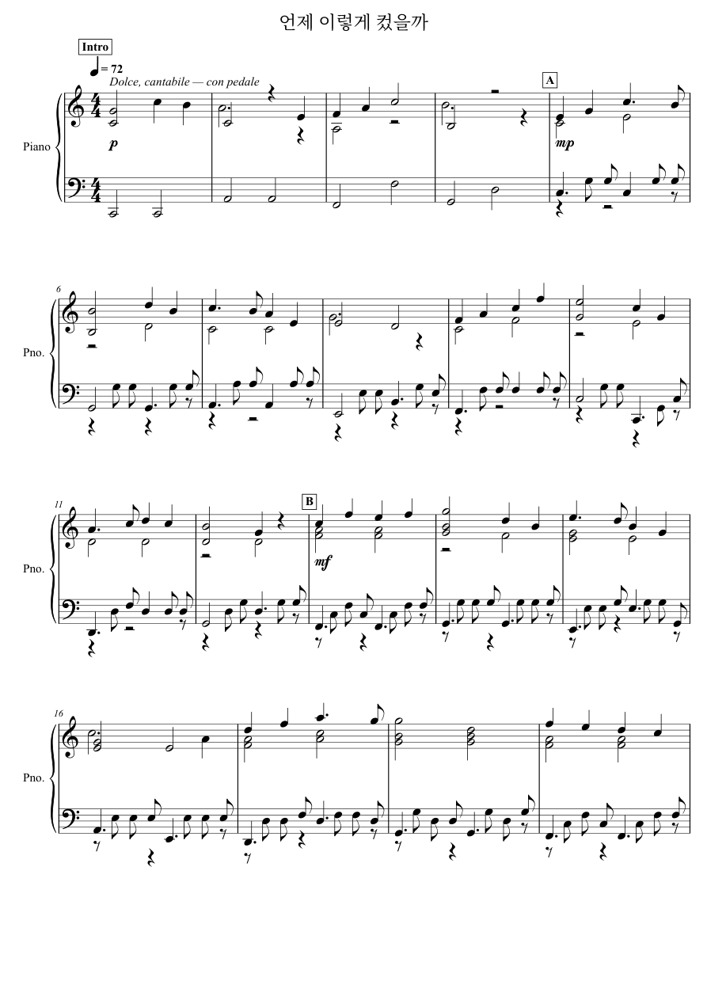
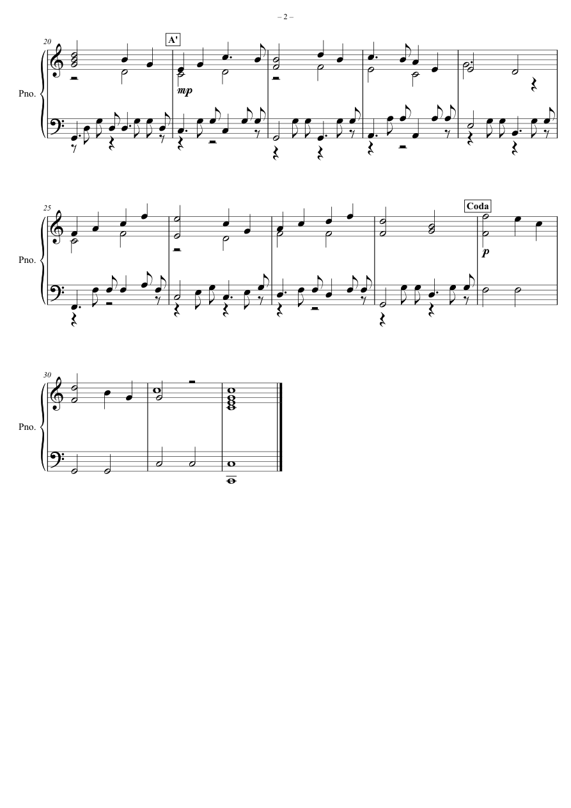

# 언제 이렇게 컸을까 · 피아노 독주

첫째 딸이 콩쿠르에서 특상을 받은 날, 대견하고 기특한 마음과 가족 덕분에 행복했던 하루를 담은 32마디 피아노 발라드입니다. 다장조, 4/4박자, ♩=72, 약 1분 53초.

[피아노 MP3](piano.mp3) · [악보 PDF](score.pdf) · [MusicXML](score.musicxml) · [MIDI](score.mid)

## 곡 구성
| 마디 | 구간 | 장면 |
|---|---|---|
| 1–4 | Intro (p) | 콩쿠르 무대 앞, 조용한 설렘 |
| 5–12 | A (mp) | 사진을 찍는 순간, 나란히 선 가족 |
| 13–20 | B (mf) | 특상 — 대견하고 기특한 마음이 벅차오름 |
| 21–28 | A' (mp) | 언제 이렇게 컸는지, 같은 선율을 다시 돌아봄 |
| 29–32 | Coda (p) | 가족 덕분에 행복한 하루 |

## 만든 방식
- 선율·화성 진행·형식·셈여림은 사연을 바탕으로 직접 작곡한 창작물입니다.
- 왼손 반주와 오른손 안쪽 성부의 음 선택은 rich 피아노 v1 모델(research-noncommercial)이 했습니다.
- 모델이 사진이나 글을 해석하지는 않았고, 장면과 음악을 연결한 것은 작곡 설정입니다.
- MP3는 Salamander 그랜드피아노 SoundFont로 합성한 확인용 음원이며, 실제 연주 녹음이 아닙니다.
- 사진 원본은 포함하지 않았습니다.
- 재생성 스크립트: [source/compose_v2.py](source/compose_v2.py)
