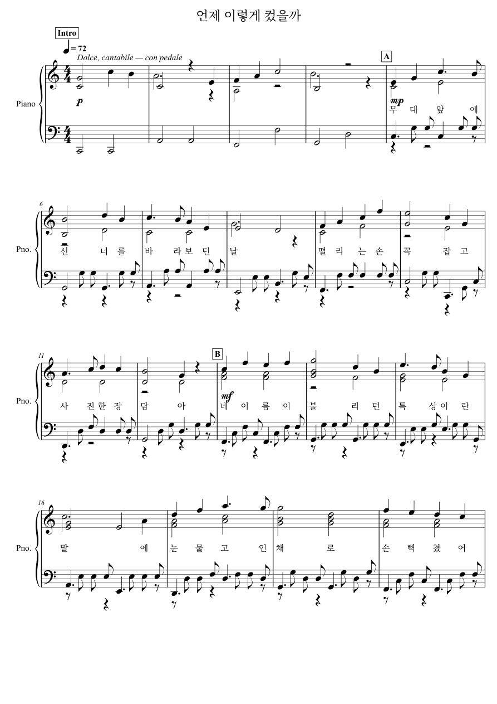
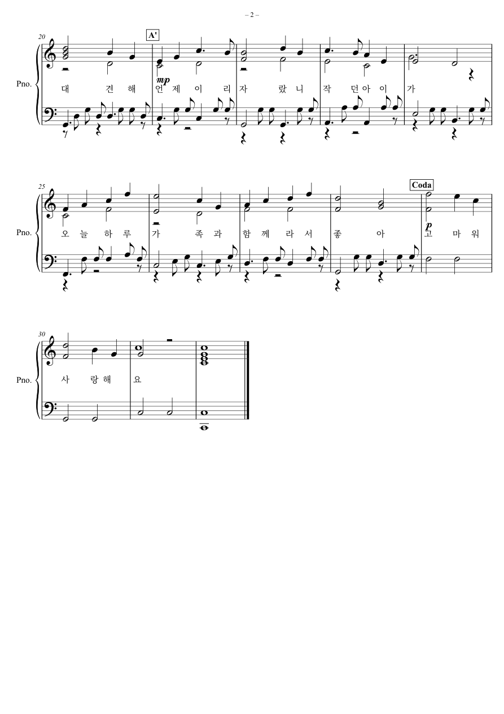

> **테스트 기록 (사용하지 않음)**
> 이 판은 선율을 먼저 완성한 뒤, 음표 수에 맞춰 가사를 나중에 끼워 넣었습니다.
> 사용자 평가는 "선율은 좋았는데 가사 문맥과 단어 선정이 맞지 않는다"였습니다.
> 그래서 이 방식은 더 쓰지 않고, 기록으로만 남깁니다.
> 현재 판은 [상위 폴더](../README.md)에 있습니다.

# 언제 이렇게 컸을까 · 노래와 피아노

첫째 딸이 콩쿠르에서 특상을 받은 날, 대견하고 기특한 마음과 가족 덕분에 행복했던 하루를 담은 32마디 피아노 발라드입니다. 다장조, 4/4박자, ♩=72, 약 1분 53초.

[가사 포함 악보 PDF](score.pdf) · [가사](lyrics.txt) · [피아노 MP3](piano.mp3) · [MusicXML](score.musicxml) · [MIDI](score.mid) · [가사 없는 피아노 악보](piano-only/score.pdf)




## 가사
```
[A]
무대 앞에 선 너를 바라보던 날
떨리는 손 꼭 잡고 사진 한 장 담아

[B]
네 이름이 불리던 특상이란 말에
눈물 고인 채로 손뼉 쳤어 대견해

[A']
언제 이리 자랐니 작던 아이가
오늘 하루 가족과 함께라서 좋아

[Coda]
고마워 사랑해요
```
가사는 오른손 선율 음표 하나에 한 음절씩 붙어 있습니다(전주 4마디와 마지막 화음은 연주만).

## 곡 구성
| 마디 | 구간 | 장면 |
|---|---|---|
| 1–4 | Intro (p) | 콩쿠르 무대 앞, 조용한 설렘 |
| 5–12 | A (mp) | 사진을 찍는 순간, 나란히 선 가족 |
| 13–20 | B (mf) | 특상 — 대견하고 기특한 마음이 벅차오름 |
| 21–28 | A' (mp) | 언제 이렇게 컸는지, 같은 선율을 다시 돌아봄 |
| 29–32 | Coda (p) | 가족 덕분에 행복한 하루 |

## 만든 방식
- 선율·화성 진행·형식·셈여림은 사연을 바탕으로 직접 작곡한 창작물입니다.
- 왼손 반주와 오른손 안쪽 성부의 음 선택은 rich 피아노 v1 모델(research-noncommercial)이 했습니다.
- 모델이 사진이나 글을 해석하지는 않았고, 장면과 음악을 연결한 것은 작곡 설정입니다.
- MP3에는 노래 목소리 없이 피아노만 들어 있습니다. Salamander 그랜드피아노 SoundFont로 합성한 확인용 음원이며, 실제 연주 녹음이 아닙니다.
- 사진 원본은 포함하지 않았습니다.
- 재생성 스크립트: [source/compose_v2.py](source/compose_v2.py), 가사 붙이기: [source/add_lyrics.py](source/add_lyrics.py)
