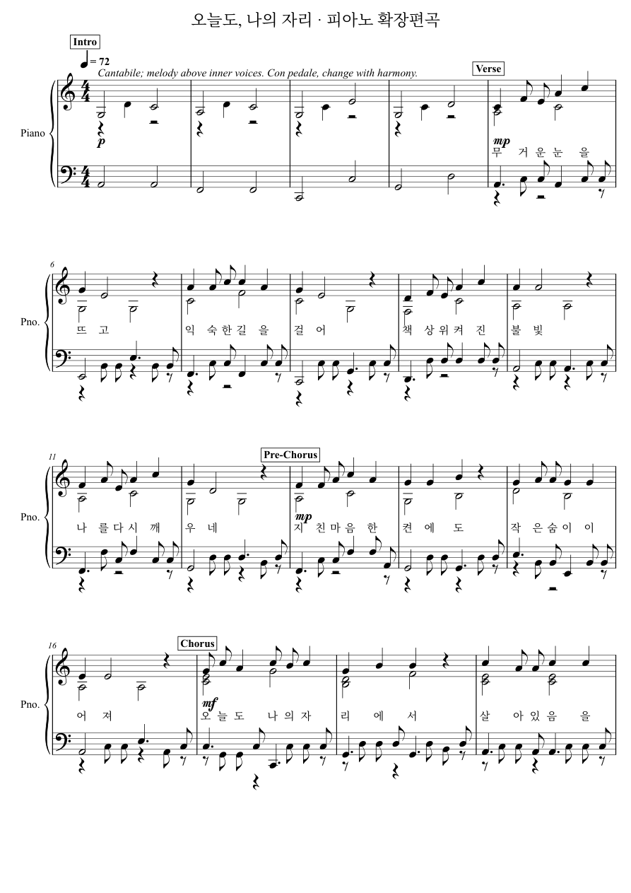

# 오늘도, 나의 자리 · 풍부한 피아노 편곡

피아노 한 종류로 멜로디·내성 화음·왼손 반주를 연주하는 새 편곡입니다. 기존 멜로디와 가사 94음절을 유지하며 221음에서 363음으로 확장했습니다.

- [새 피아노 연주 MP3](sample/piano.mp3)
- [피아노 전용 악보 PDF](sample/piano-only/score.pdf) · [가사 포함 악보 PDF](sample/piano/score.pdf)
- [악보 그대로 MIDI](sample/piano/score.mid) · [페달·표현 MIDI](sample/performance.mid) · [MusicXML](sample/piano/score.musicxml)
- [기존 편곡과 같은 피아노 음원으로 비교](comparison/baseline-same-piano.mp3)
- [전체 파일 ZIP](rich-piano-20261029.zip)

## 모델·데이터·검증

Claude와 협업해 코퍼스 1,832개를 정리했습니다. 학습 1,403개·검증 199개·평가 230개로 분리하여 가중치를 처음부터 6에포크 GPU 학습했습니다. 선택 체크포인트는 6번째 에포크입니다. 새 자료 617개가 전체 코퍼스에 포함됩니다.

[상세 학습 보고서](TRAINING-REPORT.ko.md) · [검증 결과](verification.json) · [데이터 요약](data/summary.json) · [선택 모델](model/best.pt) · [데이터](data/pieces.jsonl.gz) · [출처와 크레디트](CREDITS.txt)

테스트 240개 통과, 환경상 제외 3개. 모델·데이터는 프로젝트의 연구·비상업용 프로필이며, 학습된 부분과 작성한 편곡·연주 규칙 및 평가 한계는 보고서에 구분했습니다.

## 구현 소스

[모델·토크나이저](implementation/src/omr/piano_rich) · [수집기](implementation/scripts/collect_rich_piano.py) · [편곡 생성기](implementation/scripts/generate_rich_piano_ballad.py) · [테스트](implementation/tests/piano_rich) · [사용 방법](implementation/docs/research/2026-10-29-rich-piano-usage.md)

[실제 학습 소스 스냅샷](source/training-source.tgz)은 엄격한 체크포인트 소스 해시를 보존합니다. 구현 소스의 기준 커밋과 파일 해시는 [SOURCE-REVISION.json](SOURCE-REVISION.json)에 있습니다. 기존 검증 패키지의 파일은 변경하지 않았으며, 추가 게시 파일은 [PUBLISH-MANIFEST.json](PUBLISH-MANIFEST.json)에 기록했습니다.

## 악보 미리보기

[원본 패키지 안내](README.ko.md)
