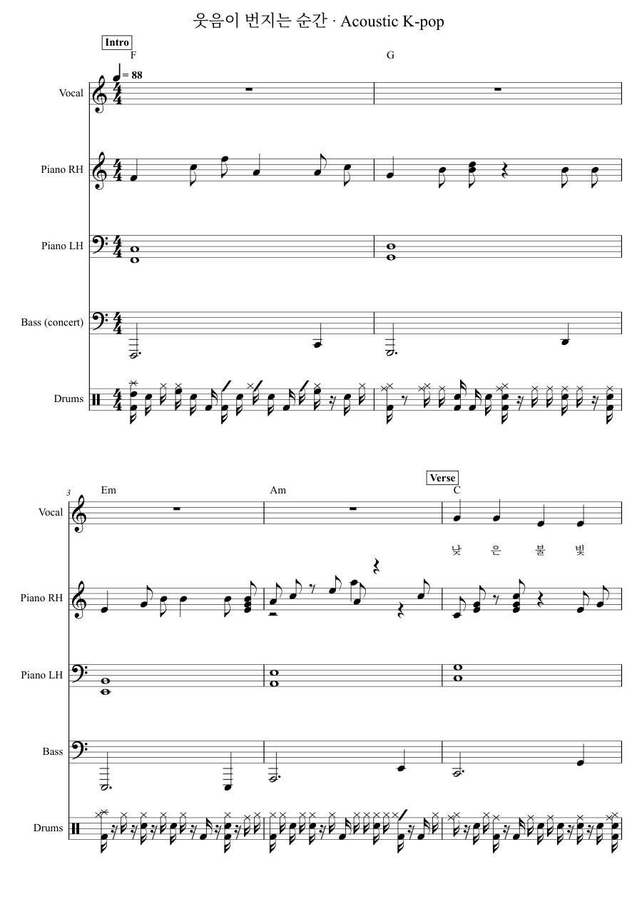
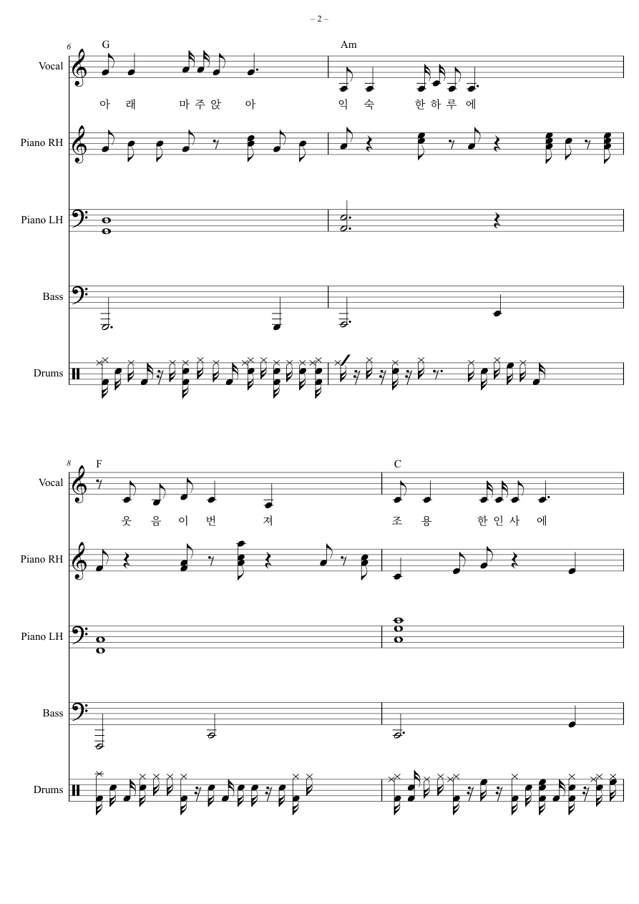
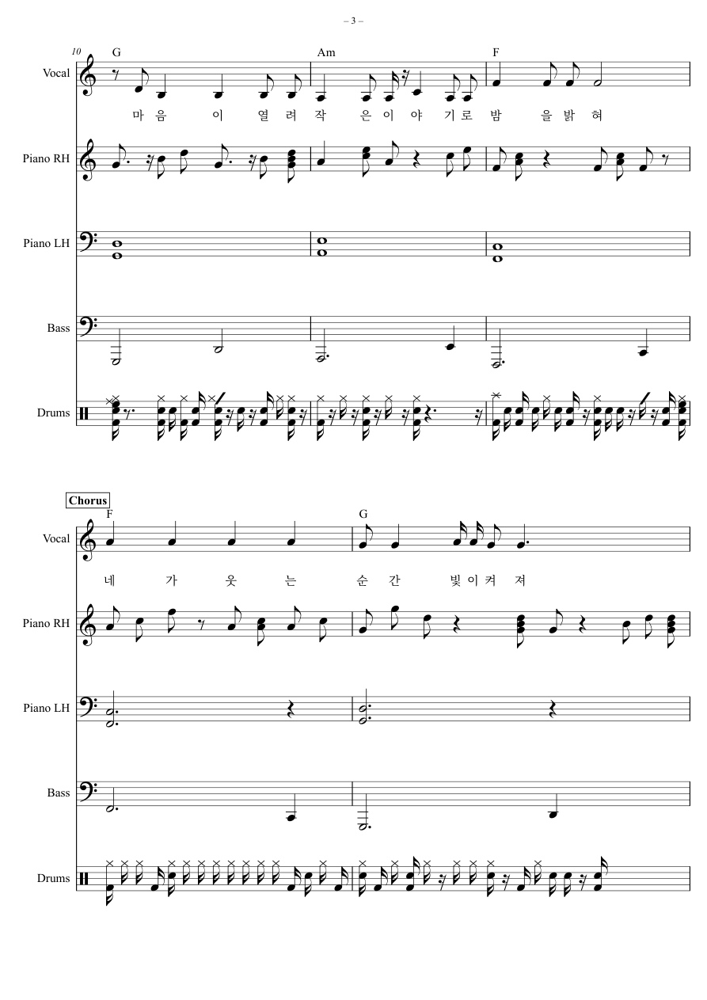
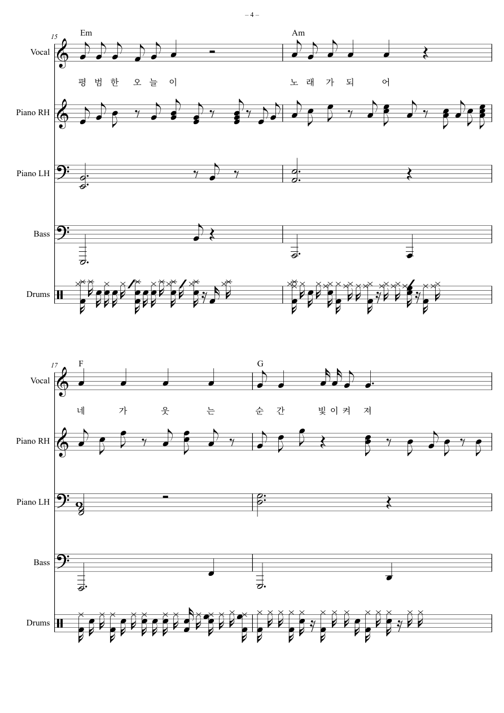
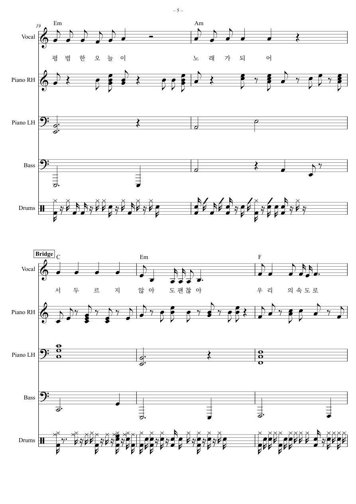
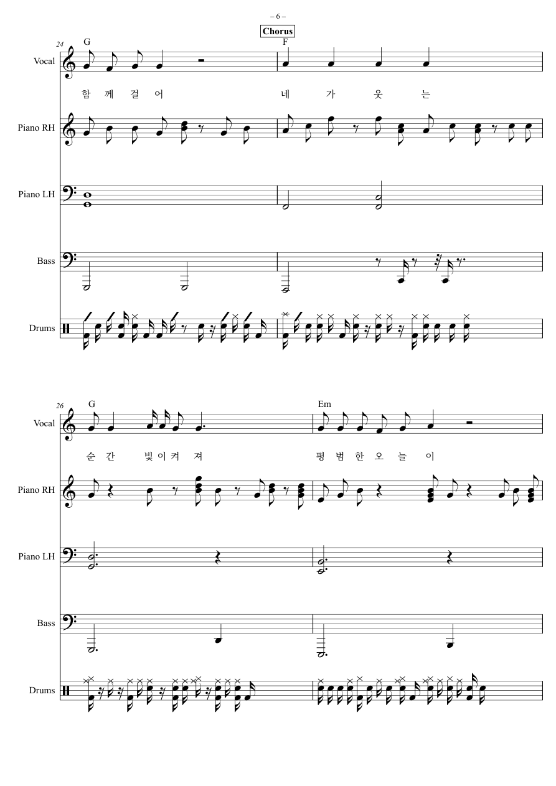
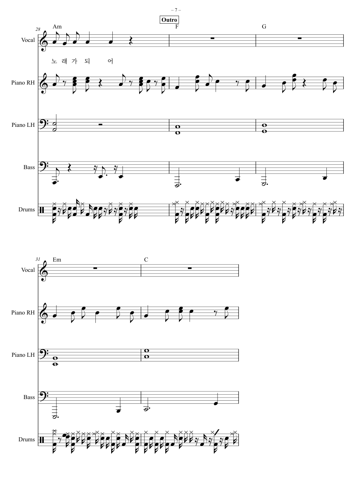

# 웃음이 번지는 순간 · Acoustic K-pop

사진의 환한 미소와 따뜻한 실내 조명에서 영감을 받아 새로 만든 한국어 노래입니다.
기존 6/8박자 버전과 별도로 만든 **4/4박자 어쿠스틱 케이팝 편곡**입니다.

- C장조 · 4/4박자 · 4분음표 = 88 · 32마디 · 약 87초
- 보컬, 피아노 오른손·왼손, 베이스, 드럼의 5개 파트
- 전주 4마디 → 벌스 8마디 → 후렴 8마디 → 브리지 4마디 → 후렴 4마디 → 후주 4마디
- 반복되는 후렴 선율, 마디별 코드 기호, 새로 작성한 한국어 가사

[인쇄용 PDF (7쪽)](score.pdf) · [편집용 MusicXML](score.musicxml) · [전체 재생 MIDI](score.mid) · [가사](lyrics.txt)

MIDI의 보컬 선율은 악기 음색으로 재생됩니다. 실제 가창 녹음은 포함하지 않습니다.
베이스는 실음으로 표기했습니다. 드럼은 읽기 쉽게 16분음표 격자로 정리했으며, 그 변경 내역은 `provenance.json`에 기록했습니다.

## 악보 미리보기



<details>
<summary>악보 2~7쪽 펼치기</summary>








</details>

## 파트별 연습 파일

[보컬 선율](vocal.mid) · [피아노 오른손](piano_rh.mid) · [피아노 왼손](piano_lh.mid) · [베이스](bass.mid) · [드럼](drums.mid)

## 생성 방법과 검증

장면 해석, 곡 구성, 가사는 이번 사진에 맞춰 직접 작성했습니다.
보컬·피아노·베이스 음표는 프로젝트의 합성 데이터 학습 Transformer에서 생성하고,
드럼은 실제 GMD 리듬을 학습한 commercial-compatible 모델의 pop 조건으로 생성했습니다.
장르와 실제 학습 스타일의 연결은 명시적인 설정이며, 사진 해석이나 케이팝 가창을 학습했다는 의미는 아닙니다.
이번 작업은 기존 체크포인트를 사용한 새 악보 생성이며, 추가 모델 학습은 수행하지 않았습니다.

160개 파트 마디의 길이, MusicXML/MIDI 음표·박자·세기 일치, 가사 125음절 보존을 검사했습니다.
렌더링한 악보에서 한글 음절 사이 하이픈 0개와 가사 간격 기준 미달 0쌍을 확인했습니다.
음표의 덧줄·붙임줄 등 실제 악보 기호는 유지했습니다.
모든 PNG는 최종 PDF의 각 페이지를 렌더링한 이미지입니다.

[검증 기록](verification.json) · [생성 이력 및 체크포인트 해시](provenance.json) · [곡 구성](plan.json) · [재생성 스크립트](reproduce.py)

재생성에는 OMR 장르 소스 커밋 `7324684d4bc41a795a9e50d5a2363e90284873ba`와 기존에 전달된 두 체크포인트가 필요합니다.
소스 체크아웃에서 `PYTHONPATH=src`를 설정하고 아래처럼 실행합니다. PDF와 페이지 이미지 출력은 별도 악보 렌더러를 사용합니다.

```text
python reproduce.py --bootstrap-checkpoint <genre-final.pt> --rhythm-checkpoint <real-final.pt> --output <new-empty-folder>
```

원본 인물 사진, 학습 데이터, 모델 가중치는 이 폴더에 게시하지 않았습니다. 기존 악보도 그대로 보존했습니다.
