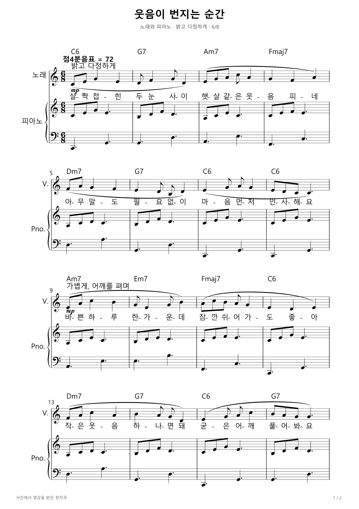
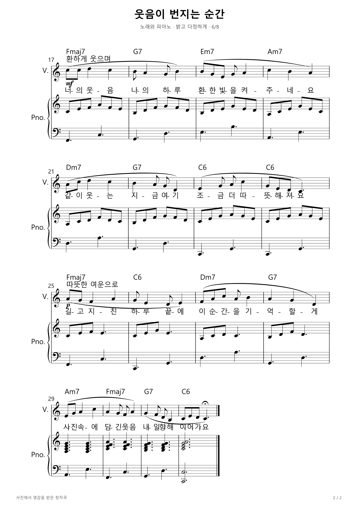

# 웃음이 번지는 순간

사진 속 환한 미소에서 영감을 받아 직접 작곡한 한국어 노래와 피아노 반주입니다. C장조, 6/8박자, 점4분음표 기준 템포 72의 32마디 곡으로 약 53초 분량입니다. 가벼운 분산화음으로 시작해 후렴에서 반주를 풍성하게 만들고, 마지막 화음에 여운을 남겼습니다.

신규 학습 모델의 자동 생성 결과나 품질 평가가 아닌 창작 예시입니다. MIDI는 악기 음색으로 선율을 재생합니다.

[인쇄용 PDF](smile-moment.pdf) · [편집용 MusicXML](smile-moment.musicxml) · [재생용 MIDI](smile-moment.mid)

## 악보 1쪽

## 악보 2쪽

