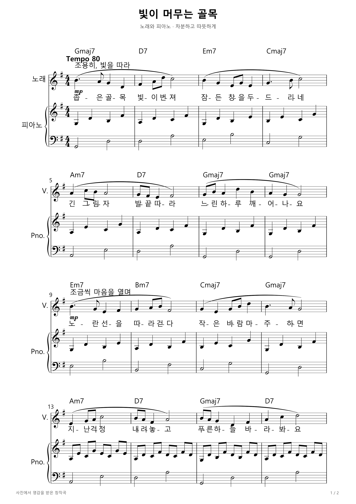
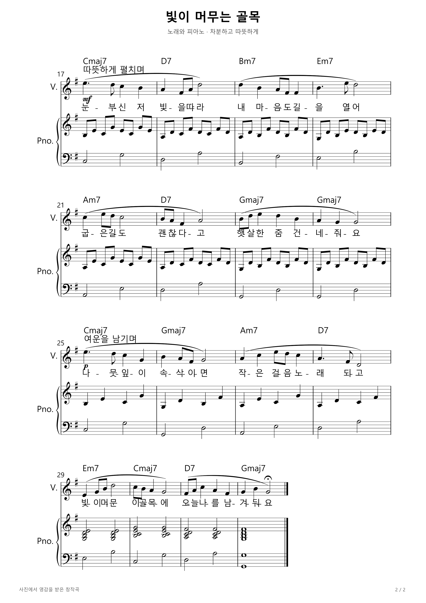

# 빛이 머무는 골목

건물 사이로 햇빛이 비치는 골목 사진에서 영감을 받아 직접 작곡한 한국어 노래와 피아노 편곡입니다. G장조, 4/4박자, 템포 80의 32마디 곡으로, 약 1분 36초 분량입니다. 조용한 도입에서 후렴으로 갈수록 피아노의 움직임이 늘어나고, 마지막에는 긴 화음으로 여운을 남깁니다.

신규 학습 모델의 자동 생성 결과나 품질 평가가 아닌 창작 예시입니다.

[인쇄용 PDF](sunlit-lane.pdf) · [편집용 MusicXML](sunlit-lane.musicxml) · [재생용 MIDI](sunlit-lane.mid)

## 악보 1쪽

## 악보 2쪽

